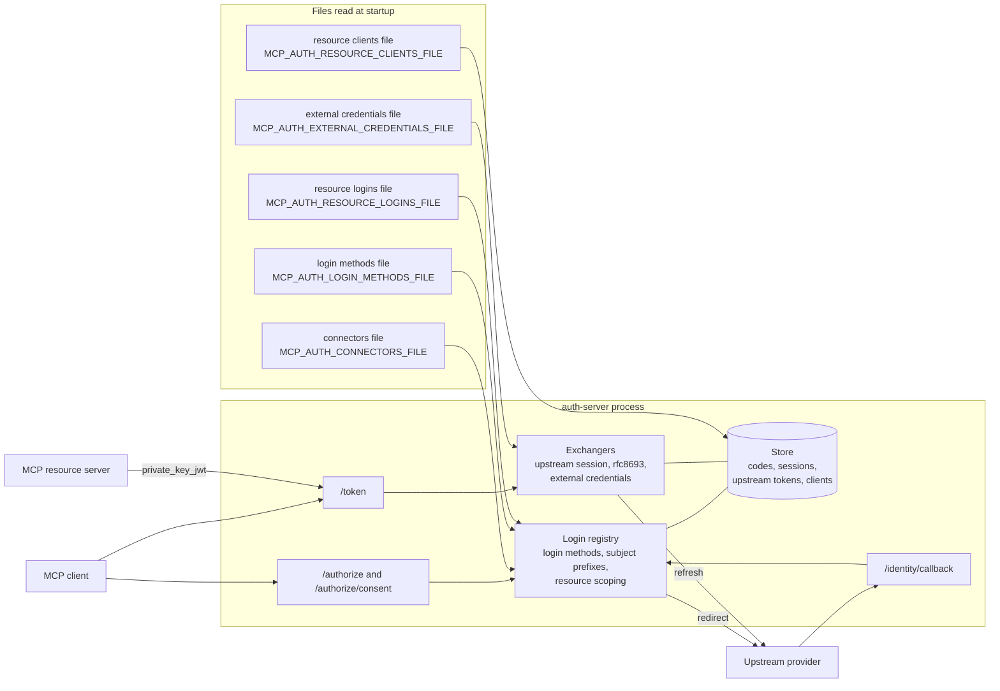
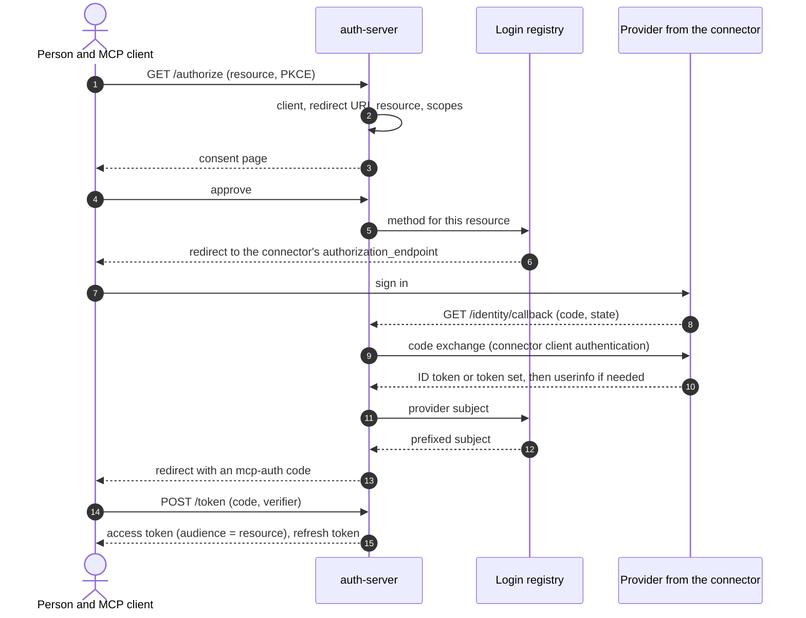
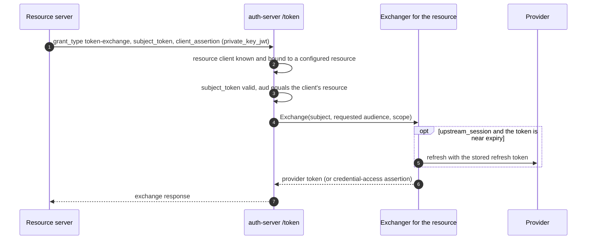

# Architecture: how connectors plug in

This page shows how sign-in configuration reaches the running server: which
component reads which file, what is read once at startup and what is used on
every request, what happens when something is wrong, and how a deployment
platform supplies the files. It does not repeat the field-by-field schemas. For
those, see [Connectors, login methods and resource logins](connectors.md). For
the OAuth flow and the trust boundaries, see [Architecture](architecture.md).

It describes the code as of v0.9.0.

## Components

| Component | Responsibility |
| --- | --- |
| Authorization endpoint | Validates the request (client, redirect URI, `resource`, PKCE), shows consent, then asks the login registry to start a sign-in. |
| Login registry | Holds the enabled login methods. Chooses the method for a resource, prefixes the provider's subject, binds the sign-in to the browser, throttles credential forms. |
| Connectors file | A named description of each upstream OAuth 2.0 or OIDC provider. Used by `oidc` login methods and by `MCP_AUTH_CONNECTOR`. |
| Login methods file | The list of methods on the login page. An `oidc` method refers to a connector by name. |
| Resource logins | Login methods scoped to particular resources, either in the methods file or in their own file next to a single connector. |
| Resource clients | Pre-registered resource servers (public keys) allowed to call the token endpoint with `private_key_jwt`. |
| Token endpoint | Issues codes, tokens and refresh tokens, and serves the RFC 8693 token exchange. |
| Exchangers | Produce the credential a resource server receives on exchange: the stored provider token (`upstream_session`), a provider-side exchange (`rfc8693`), or a credential-access assertion (external credentials). |

## Where each file is read

These are the exact environment variables, as defined in
`auth-server/server/config.go`:

| Variable | File contents | Notes |
| --- | --- | --- |
| `MCP_AUTH_CONNECTORS_FILE` | JSON object of connectors keyed by name | Required with `MCP_AUTH_CONNECTOR`. Also used by `oidc` methods. |
| `MCP_AUTH_CONNECTOR` | Name of the single connector | Cannot be combined with `MCP_AUTH_LOGIN_METHODS_FILE`. |
| `MCP_AUTH_LOGIN_METHODS_FILE` | `{"methods": [...]}` | Several methods on one login page. Replaces `MCP_AUTH_CONNECTOR`. |
| `MCP_AUTH_RESOURCE_LOGINS_FILE` | `{"methods": [...]}`, each with `resources` and a non-empty `subject_prefix` | Needs `MCP_AUTH_CONNECTOR`. Cannot be combined with `MCP_AUTH_LOGIN_METHODS_FILE`. |
| `MCP_AUTH_RESOURCE_CLIENTS_FILE` | Resource clients with public keys | Each client's resource must be in `MCP_AUTH_RESOURCES`. |
| `MCP_AUTH_EXTERNAL_CREDENTIALS_FILE` | External credential connectors | See [External credentials](external-credentials.md). |
| `MCP_AUTH_STRICT_LOGIN_METHODS` | `true` restores fail-fast loading of login methods | See [Failure behavior](#failure-behavior). |

Secrets are never in these files. A connector names an environment variable
(`client_secret_env`, `client_id_env`) and the process reads its value from its
environment.

## Startup and per-request work

The files and variables above are read **once, when the process starts**.
Editing a file or an environment variable has no effect on a running process;
restart it. Requests then use what was loaded.

| When | What happens |
| --- | --- |
| Startup | Configuration is validated. The connectors file is loaded; missing OIDC endpoints are discovered from `<issuer>/.well-known/openid-configuration`. Login methods and resource logins are loaded and validated. Resource clients are written to the store (the file is the source of truth and is re-applied on every start). External credentials are loaded. Exchangers are built. |
| Per sign-in | The authorization endpoint resolves the login method for the resource. The browser is redirected to the provider; the callback exchanges the code at the provider's token endpoint and verifies the ID token or calls userinfo. The provider's signing keys are fetched and cached as needed. |
| Per token request | The token endpoint issues or refreshes MCP tokens from the store. |
| Per exchange | The resource client is authenticated, the subject token must be a valid access token whose audience is the client's bound resource, and the exchanger for that resource produces the credential. An upstream session is refreshed here when needed. |

## Lifecycle of a sign-in

Choosing the method: a method with `resources` is required for exactly those
resources. A resource with no scoped method uses the unscoped methods. One
matching redirect method skips the picker. If the scoped method is disabled,
authorization is refused with `access_denied`; there is no fallback.

## Lifecycle of a token exchange

The exchanger is chosen by the resource: an external credential connector for
that resource first, then an exchanger registered for that resource by a method
with `downstream_token`, then the single connector's exchanger. If none exists,
the grant is refused as `unsupported_grant_type`.

## Failure behavior

| Situation | Behavior |
| --- | --- |
| A login method names a connector missing from the connectors file, has an unknown field, or a missing secret variable | Since v0.9.0 the method is disabled: ERROR log with its id and reason, absent from the login page, `/readyz` stays `200` and lists `login_methods_disabled`. A resource scoped to it is refused with `access_denied`. Before v0.9.0 the process exited. |
| `MCP_AUTH_STRICT_LOGIN_METHODS=true` | Any invalid method stops startup, as before v0.9.0. Use it in a CI check. |
| Every method disabled in login-methods mode | Startup fails: nobody could sign in. |
| Connectors file unreadable or any connector invalid; unknown connector selected by `MCP_AUTH_CONNECTOR`; colliding subject prefixes; unparsable methods file; resource login without `resources` or a subject prefix | Startup fails. |
| A resource client names a resource not in `MCP_AUTH_RESOURCES` | Startup fails. |
| A resource login names a resource not in `MCP_AUTH_RESOURCES` | Startup fails. |
| Connector defined but not selected or referenced | Logged as a warning, not served. |
| Provider discovery fails at startup (a connector that omits its endpoints) | Startup fails with the connector name and the discovery error. |
| Provider unreachable at sign-in | That sign-in fails; other methods are unaffected. |

Alert on `login_methods_disabled` in `/readyz` or the log: a disabled method
means some people cannot sign in.

## Deploying with MCP Runtime

MCP Auth reads plain files, so any platform only needs to mount the same files
and set the same variables. MCP Runtime does it for the `mcp-auth-server`
Deployment in the `mcp-platform` namespace:

| Kubernetes object | Holds | How the server sees it |
| --- | --- | --- |
| ConfigMap `mcp-auth-connectors` | `connectors.json` | Mounted at `/etc/mcp-auth`; `MCP_AUTH_CONNECTORS_FILE` and `MCP_AUTH_CONNECTOR` are set |
| Secret `mcp-auth-connector-secrets` | The values of the variables named by `client_secret_env` and `client_id_env` | `envFrom` on the container |
| ConfigMap `mcp-auth-gateway-wiring` | `resource-logins.json`, `resource-clients.json`, and for a credential gateway `external-credentials.json` and public keys | Mounted at `/etc/mcp-auth-gateway-wiring`; the three `..._FILE` variables point into it |

These MCP Runtime commands write them:

- `mcp-runtime setup --with-mcp-auth-server --mcp-auth-connectors-file <file> --mcp-auth-connector <name>`
  installs the server with the main connector.
- `mcp-runtime cluster mcp-auth connector apply` replaces the main connector's
  file. It updates the ConfigMap only, so restart the Deployment afterwards.
- `mcp-runtime cluster mcp-auth resource apply` adds one resource's login method,
  resource client and connector, and restarts the server when something changed.
- `mcp-runtime gateway apply` installs the credential gateway and wires its
  form login: a connector, a resource login, an assertion client and its public key.

Each wiring change that writes the Deployment carries a hash annotation on the
pod template, so a changed file rolls the pods. Entries are owned by name
prefix (`gateway-login-`, `resource-login-`, `form-`, `res-`); the commands keep
entries they do not own. See MCP Runtime's documentation for the flags.

## Which file do I edit

| I want to | Edit | Then |
| --- | --- | --- |
| Add or change an upstream provider's endpoints, client id, scopes or claims | The connectors file | Restart |
| Put the provider behind a sign-in button, or change its label or prefix | The login methods file (an `oidc` method naming the connector) | Restart |
| Require a particular sign-in for one resource | A method with `resources` (methods file, or resource logins file next to a single connector) | Restart |
| Hand the provider's token to a resource server | `downstream_token` on that resource's `oidc` method, or the connector's `downstream_token_strategy` | Restart |
| Let a resource server call the token exchange | The resource clients file (public key) | Restart |
| Let a resource server fetch a credential-access assertion | The external credentials file | Restart |
| Rotate a provider client secret | The environment variable named by `client_secret_env` | Restart |

Every row ends with a restart because all of these are read at startup.
