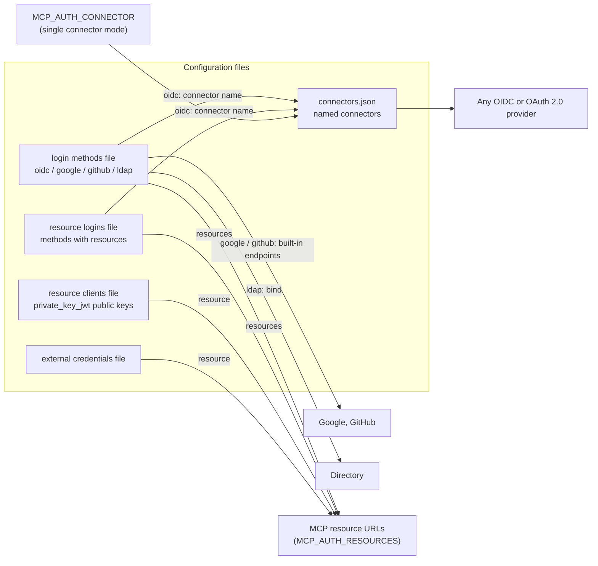

# Connectors, login methods and resource logins

This page is the inventory of what `mcp-auth` can sign people in with, how the
pieces fit together, and how to add a provider that is not built in. It
describes the code as of the release it ships with. For tutorials see
[Login methods](login-methods.md) and
[Authorization server](auth-server.md); for the gateway that collects header
credentials see [Resource logins for a credential gateway](credential-gateway.md).

## Vocabulary

| Term | What it is | Where it is configured |
| --- | --- | --- |
| **Connector** | A named description of one upstream OAuth 2.0 or OIDC provider: endpoints, client id and secret, scopes, PKCE and nonce policy. It carries no behavior of its own. | `MCP_AUTH_CONNECTORS_FILE`, a JSON object keyed by connector name |
| **Login method** | One way a person proves who they are: a redirect to a provider (`oidc`, `google`, `github`) or a form on this server's login page (`ldap`). Has an `id`, a label and a subject prefix. | `MCP_AUTH_LOGIN_METHODS_FILE`, a JSON `methods` list |
| **Resource login** | A login method scoped to particular MCP resources with `resources`. A resource with a scoped method must sign in through it; it never falls back to another method. | The same `methods` list (with `resources`), or `MCP_AUTH_RESOURCE_LOGINS_FILE` next to a single connector |
| **Resource client** | A resource server pre-registered to call the token-exchange endpoint with `private_key_jwt`. It is not a way to sign in. | `MCP_AUTH_RESOURCE_CLIENTS_FILE` |
| **External credential connector** | Lets a resource client obtain a short-lived credential-access assertion instead of an upstream token. Not a way to sign in. | `MCP_AUTH_EXTERNAL_CREDENTIALS_FILE`, see [External credentials](external-credentials.md) |

Only a login method signs people in. A connector is used by an `oidc` method
(or by `MCP_AUTH_CONNECTOR`) and does nothing on its own.



## Sign-in modes

Exactly one of these is active in a process. They are chosen by environment
variables, checked at startup:

| Mode | Set | Behavior |
| --- | --- | --- |
| Single connector | `MCP_AUTH_CONNECTOR` + `MCP_AUTH_CONNECTORS_FILE` | One provider signs everyone in. The connector's `downstream_token_strategy` applies. Optionally add resource logins (below). |
| Login methods | `MCP_AUTH_LOGIN_METHODS_FILE` (replaces `MCP_AUTH_CONNECTOR`; both is an error) | Several methods on one login page. Methods with `resources` are required for those resources. |
| Single connector with resource logins | `MCP_AUTH_CONNECTOR` + `MCP_AUTH_RESOURCE_LOGINS_FILE` | Everything uses the connector except the resources the file names. Each method must set `resources` and a non-empty `subject_prefix`. Cannot be combined with `MCP_AUTH_LOGIN_METHODS_FILE`. |
| Local development | `MCP_AUTH_LOCAL_DEVELOPMENT=true`, nothing else | A fixed subject, with warnings. Never for production. |

## What is supported today

### Login method types: 4

| `type` | Shape | Provider | Page behavior |
| --- | --- | --- | --- |
| `oidc` | Redirect | Any connector from the connectors file: OIDC or plain OAuth 2.0 | Browser leaves for the provider |
| `google` | Redirect | Google (fixed endpoints, OIDC) | Browser leaves for Google |
| `github` | Redirect | GitHub or GitHub Enterprise Server (OAuth 2.0 plus API lookups) | Browser leaves for GitHub |
| `ldap` | Credential form | A directory over LDAP (bind as the person) | Form on the login page |

There are no other types. Anything not in this table is configured through
`oidc` and a connector, or needs new code (see
[Writing a custom connector](#writing-a-custom-connector)).

### Connector kinds: 1 schema, 3 profiles

There is one connector schema (`ConnectorConfig`). It is used in three ways,
chosen by its settings, not by a `type` field:

| Profile | How to recognise it | Examples |
| --- | --- | --- |
| **OIDC** | `scopes` contains `openid` or is empty. The provider must return an ID token; it is verified (signature, issuer, audience, expiry, `iat`/`nbf`, nonce). | Keycloak, Okta, Entra ID, Dex, Google through a connector |
| **Plain OAuth 2.0** | `scopes` is set and omits `openid`. No ID token; identity comes from `userinfo_endpoint` and `identity_claims`. | A provider that only offers OAuth 2.0 (set `pkce` and `id_token_nonce_policy` as the provider needs) |
| **Sign-in endpoints of a gateway** | A plain OAuth 2.0 connector pointing at a service's own `/login/authorize`, `/login/token`, `/login/userinfo`. | The credential gateway's header-credential form (below) |

There are **no presets** for GitHub, Google or Keycloak in the connectors file.
Google and GitHub are the built-in `google` and `github` method types, whose
endpoints are fixed in code; Keycloak and everything else use a generic
connector.

### The credential form is not a connector type

The sign-in form that collects header values (username, token and so on) is
**not** a connector or method type in `mcp-auth`. It is served by a separate
gateway ([MCP Runtime's `mcp-gateway`](https://github.com/tavric-labs/mcp-runtime)
in credential mode). `mcp-auth` sees it as a plain OAuth 2.0 connector plus an
`oidc` resource login that sends one resource to it. The values never reach
`mcp-auth`. See [the credential gateway guide](credential-gateway.md) and
[worked example: credential gateway](#worked-example-credential-gateway).

### Downstream token strategies

How a resource server gets a credential to call a downstream API:

| Strategy | Set on | Behavior |
| --- | --- | --- |
| `upstream_session` (default for a connector) | connector `downstream_token_strategy` | Keeps the provider's token set from login, hands it out through RFC 8693 token exchange, refreshes it with the refresh token. Works with any provider. |
| `rfc8693` | connector `downstream_token_strategy` | Performs RFC 8693 token exchange against the provider. Only for providers that implement it. |
| method-level `upstream_session` | login method `downstream_token` | Same keeping and refreshing, for one `oidc` method scoped to `resources`. At most one such method per resource. Works in login-methods mode and next to a single connector. |
| none | the default for login methods | The provider's token is discarded; only identity is kept. |
| credential-access assertion | `MCP_AUTH_EXTERNAL_CREDENTIALS_FILE` | A signed assertion, not an upstream token. See [External credentials](external-credentials.md). |

The connector-wide strategy is not available in login-methods mode (there is
no single connector); use the per-method `downstream_token` or external
credentials.

## Connector schema

Every field of an entry in `MCP_AUTH_CONNECTORS_FILE`. Unknown fields are
rejected, so a misspelling fails at load. A literal `client_secret` is always
rejected; use `client_secret_env`. All URLs must be `https` unless
`MCP_AUTH_ALLOW_INSECURE_CONNECTORS` or local development is on.

| Field | Type | Required | Default | Meaning |
| --- | --- | --- | --- | --- |
| `issuer` | string | yes (see discovery) | none | Compared with the ID token `iss`. If an endpoint below is missing, it is discovered from `<issuer>/.well-known/openid-configuration`. |
| `authorization_endpoint` | URL | yes | discovered | Where the browser is sent. |
| `token_endpoint` | URL | yes | discovered | Code exchange. |
| `jwks_uri` | URL | for OIDC only | discovered | ID token signing keys. Not needed for a plain OAuth 2.0 connector. |
| `userinfo_endpoint` | URL | no | discovered | Supplies identity claims when they are not in the ID token; required for plain OAuth 2.0. |
| `token_endpoint_internal` | URL | no | none | Private URL for the server-side code exchange. Needs `token_endpoint_server_name`. |
| `jwks_uri_internal` | URL | no | none | Private JWKS URL. Needs `token_endpoint_server_name`. |
| `token_endpoint_server_name` | string | with either `*_internal` | none | TLS server name checked for the internal URLs. |
| `client_id` / `client_id_env` | string | exactly one | none | OAuth client id, literal or from an environment variable. |
| `client_secret_env` | string | unless auth method is `none` | none | Environment variable holding the client secret. |
| `token_endpoint_auth_method` | string | yes | none | `client_secret_basic`, `client_secret_post` or `none` (public client). |
| `exchange_client_id` | string | yes | none | Client id used for RFC 8693 exchange. Any non-empty value (for example `unused`) when the connector is only used for login. |
| `scopes` | string list | no | `["openid"]` | Requested scopes. Decides OIDC versus plain OAuth 2.0. |
| `pkce` | bool | no | `true` | Set `false` only for a provider that refuses client-secret authentication on a PKCE code. Rejected with auth method `none`. |
| `id_token_nonce_policy` | string | no | `required` | `required` or `disabled`. Disable only for a provider whose ID tokens omit `nonce`. |
| `allowed_algorithms` | string list | no | `["RS256"]` | ID token algorithms: `RS256`, `PS256`, `ES256`. |
| `identity_claims` | string list | no | `["sub"]` | Claims tried in order for the subject; userinfo is called when none is present. |
| `downstream_token_strategy` | string | no | `upstream_session` | `upstream_session` or `rfc8693`. Single-connector mode only. |
| `allowed_upstream_callback_uris` | URL list | no | any | Which of this server's `/identity/callback` URLs may be registered with the provider. |
| `allowed_client_redirect_uris` | URL list | no | any | Restricts MCP client redirect URIs. Single-connector mode only. |
| `consent` | object | no | built-in page | Consent page text: `display_name`, `website_url`, `page_title`, `subtitle`, `intro_paragraphs`, `permissions`, `scope_labels`, `upstream_sso_label`, `support_url`. Single-connector mode only. |

PKCE and nonce options in one place:

- **PKCE** (`pkce`): S256 is sent to the provider by default. `false` sends no
  `code_challenge` or `code_verifier`; it requires a client secret.
- **Nonce** (`id_token_nonce_policy`): `required` binds the ID token to the
  request. `disabled` skips only that check. Signature, issuer, audience and
  expiry are still verified. A plain OAuth 2.0 connector has no ID token, so
  the nonce does not apply there.

## Login method schema

Common to every method:

| Field | Type | Required | Default | Meaning |
| --- | --- | --- | --- | --- |
| `id` | string | yes | none | 1-32 characters of `a-z`, `0-9`, `-`, starting with a letter or digit. Unique. Used in URLs. |
| `type` | string | yes | none | `oidc`, `google`, `github` or `ldap`. |
| `label` | string | no | per type, such as `Sign in with <connector>` | Text on the login page. |
| `resources` | URL list | no (required for resource logins) | none | Exact resource URLs the method serves. Unique absolute HTTP(S) URLs without userinfo, query or fragment. |
| `subject_prefix` | string | no | `<id>:` | Prefixed to the provider's subject. An explicit empty string keeps the provider's own subject; at most one method may do that. Prefixes may not be equal or begin one another. |

Per type:

| Type | Fields |
| --- | --- |
| `oidc` | `connector` (required, a name in the connectors file), `downstream_token` (`upstream_session`, needs `resources`) |
| `google` | `client_id` or `client_id_env`, `client_secret_env` (required), `allowed_domains` |
| `github` | `client_id` or `client_id_env`, `client_secret_env` (required), `allowed_orgs`, `base_url`, `api_url` |
| `ldap` | `url`, `start_tls`, `ca_file`, `bind_dn`, `bind_password_env`, `anonymous_search`, `user_search_base`, `user_filter`, `user_dn_template`, `subject_attribute` (required), `claims`, `username_label`, `password_label` |

Field-by-field meaning for `google`, `github` and `ldap` is in
[Login methods](login-methods.md#method-types).

## How a resource picks its sign-in

1. A method with `resources` is a requirement for exactly those resources. A
   user cannot choose a weaker method instead.
2. A resource with no scoped method uses the methods that have no `resources`.
3. One matching method that redirects skips the picker. Anything else shows
   the login page.
4. If the scoped method for a resource is **disabled** (see
   [Invalid methods are disabled](#invalid-methods-are-disabled-not-fatal)),
   the resource has no sign-in and authorization is refused with
   `access_denied`. It never falls back to another method or to the single
   connector.

## Invalid methods are disabled, not fatal

Behavior change after v0.8.0 (see `CHANGELOG.md`).

A login method whose own configuration is invalid no longer stops the server.
It is **disabled**: it cannot authenticate anyone, it is not on the login page,
and a direct request to it is refused. Every valid method keeps working.

What happens at startup:

- A `slog` **ERROR** line per method: `login method disabled: it cannot
  authenticate anyone until its configuration is fixed`, with `method`, `type`,
  `resources` and `error` (for example `connector "x" is not in the connectors
  file`).
- One summary ERROR with `login_methods_disabled` and `login_methods_enabled`
  counts.
- `GET /readyz` stays `200` and lists the ids:
  `{"status":"ready","login_methods_disabled":["form-gitlab"]}`. Reasons and
  connector names are only in the log. With nothing disabled the body is
  unchanged: `{"status":"ready"}`.

What is disabled, per method: a connector name missing from the connectors
file, an unknown or missing `type`, a misspelled or unsupported field, a missing
secret environment variable, an invalid LDAP or Google or GitHub setting, an
invalid `downstream_token`.

What still stops startup (fail closed):

- an unparsable methods file, unknown top-level keys, or no methods at all;
- a method with a missing, malformed or duplicate `id`;
- a method with an invalid `resources` list or a `subject_prefix` of the wrong
  type;
- subject prefixes that collide or overlap between enabled methods;
- a resource login without `resources`, or with an empty `subject_prefix`, in
  `MCP_AUTH_RESOURCE_LOGINS_FILE`;
- a connectors file that cannot be read or has any invalid connector;
- in login-methods mode, every method disabled (nobody could sign in);
- the selected `MCP_AUTH_CONNECTOR` missing, an invalid signing key, an
  invalid issuer, and every other non-login setting.

Set `MCP_AUTH_STRICT_LOGIN_METHODS=true` to restore fail-fast loading, for
example in a CI step that validates configuration before it is deployed.
Alert on `login_methods_disabled` in `/readyz` or the log: a disabled method
means some people cannot sign in.

## Worked examples

### Generic OIDC provider (Keycloak, Okta, Entra ID, Dex)

`connectors.json`:

```json
{
  "okta": {
    "issuer": "https://id.example.com",
    "client_id_env": "OKTA_CLIENT_ID",
    "client_secret_env": "OKTA_CLIENT_SECRET",
    "token_endpoint_auth_method": "client_secret_basic",
    "exchange_client_id": "mcp-auth",
    "scopes": ["openid", "profile", "email"],
    "allowed_upstream_callback_uris": ["https://auth.example.com/identity/callback"]
  }
}
```

The three endpoints and `jwks_uri` are discovered from the issuer. Single
connector: `MCP_AUTH_CONNECTOR=okta`. Login methods:

```json
{"methods": [{"id": "okta", "type": "oidc", "connector": "okta"}]}
```

### Google

```json
{"id": "google", "type": "google", "client_id_env": "GOOGLE_CLIENT_ID",
 "client_secret_env": "GOOGLE_CLIENT_SECRET", "allowed_domains": ["example.com"]}
```

### GitHub

```json
{"id": "github", "type": "github", "client_id_env": "GITHUB_CLIENT_ID",
 "client_secret_env": "GITHUB_CLIENT_SECRET", "allowed_orgs": ["acme"]}
```

### LDAP

```json
{"id": "corp", "type": "ldap", "url": "ldaps://ldap.example.com",
 "bind_dn": "cn=svc,dc=example,dc=com", "bind_password_env": "LDAP_BIND_PASSWORD",
 "user_search_base": "ou=people,dc=example,dc=com", "user_filter": "(uid={username})",
 "subject_attribute": "entryUUID", "claims": {"email": "mail"}}
```

### Plain OAuth 2.0 provider with no ID token

[`examples/connectors.oauth2-only.example.json`](../examples/connectors.oauth2-only.example.json)
and [`examples/login-methods.oauth2-only.example.json`](../examples/login-methods.oauth2-only.example.json).
This is the shape of a provider such as LinkedIn: no `openid` scope, identity
from userinfo, no PKCE, no nonce.

### Handing the provider's token to a resource

```json
{"id": "example", "type": "oidc", "connector": "example-oauth2",
 "subject_prefix": "example:", "resources": ["https://auth.example.com/example/mcp"],
 "downstream_token": "upstream_session"}
```

The token is stored in the database, so protect it as a credential store. See
[Handing the provider's token to a resource](login-methods.md#handing-the-providers-token-to-a-resource).

### Worked example: credential gateway

The header-credential form is wired with an ordinary connector and a resource
login. Per service `<id>`, the connector points at the gateway's sign-in
endpoints:

```json
{
  "gateway-login-<id>": {
    "issuer": "https://auth.example.com/<id>/mcp/login",
    "authorization_endpoint": "https://auth.example.com/<id>/mcp/login/authorize",
    "token_endpoint": "https://auth.example.com/<id>/mcp/login/token",
    "userinfo_endpoint": "https://auth.example.com/<id>/mcp/login/userinfo",
    "client_id": "login-<id>",
    "exchange_client_id": "unused-in-login-registry-mode",
    "token_endpoint_auth_method": "none",
    "scopes": ["profile"],
    "identity_claims": ["sub"],
    "allowed_upstream_callback_uris": ["https://auth.example.com/identity/callback"]
  }
}
```

and the login that sends the resource to it:

```json
{"id": "form-<id>", "type": "oidc", "connector": "gateway-login-<id>",
 "subject_prefix": "form-<id>:", "resources": ["https://auth.example.com/<id>/mcp"]}
```

The connector name, the method id and the `subject_prefix` are conventions of
the gateway's tooling, not of `mcp-auth`. They derive from the service `<id>`,
so pick a service id that names the real service (`gitlab`), not an example id.
Both files must be kept in step: a method whose connector is missing is
disabled (see above), and its resource then cannot sign in.

## Naming scheme for generated ids

`mcp-auth` accepts any connector name and any method id that matches the
patterns above; it assigns no meaning to a name. Names matter only to the
tooling that generates them. What exists today in MCP Runtime, for a service
`<id>`:

| Thing | Credential gateway | OAuth resource command |
| --- | --- | --- |
| Method id | `form-<id>` | `res-<id>` |
| Connector name | `gateway-login-<id>` | `resource-login-<id>` |
| Subject prefix | `form-<id>:` | `res-<id>:` |
| Gateway sign-in client id | `login-<id>` | not applicable |

These are already kind-prefixed, and none contains `demo`. A name like
`form-credential-form-demo` arises only because the service id was copied from
the demo example (`credential-form-demo`). Recommendations:

- Treat `<id>` as the real service name. Do not reuse an example id in a
  deployment. Method ids are limited to 32 characters, so keep `<id>` at 27 or
  fewer.
- Keep the generated prefixes as they are. They are the contract between the
  tooling and what is stored.
- The subject prefix is the one part of the name that is **stored**: it is the
  token `sub`, the refresh-token family owner and, for the credential gateway,
  the key of its in-memory value store. Renaming a prefix signs everyone out of
  that resource and orphans their records. Renaming only the method id or the
  connector name is safe for stored data (they appear only in the short-lived
  sign-in state), provided `subject_prefix` is written explicitly at its old
  value.

## Writing a custom connector

There are two paths. Use the no-code path unless the provider cannot be
described by a connector or needs behavior the connector schema lacks.

### No-code path: describe the provider in connectors.json

Works for any provider that implements the authorization-code flow.

Checklist:

1. **Register an OAuth app** with the provider. Its redirect URI is
   `<MCP_AUTH_ISSUER>/identity/callback` (or `MCP_AUTH_IDENTITY_CALLBACK_URL`).
2. **Decide the profile.** Does the provider return an ID token? If it
   supports OpenID Connect, use `openid` in `scopes` and give `issuer`; the
   endpoints and keys are discovered. If it is OAuth 2.0 only, omit `openid`,
   set `authorization_endpoint`, `token_endpoint`, `userinfo_endpoint` and
   `identity_claims` naming a claim userinfo really returns.
3. **Pick the client authentication** the token endpoint accepts:
   `client_secret_basic`, `client_secret_post`, or `none` for a public client.
   Put the secret in an environment variable and name it in
   `client_secret_env`.
4. **PKCE.** Leave `pkce` unset unless the provider rejects client-secret
   authentication on a PKCE code (it answers the code exchange with
   `invalid_client`). Then set `"pkce": false`; this needs a client secret.
5. **Nonce.** Leave `id_token_nonce_policy` unset for OIDC. Set `disabled`
   only if the provider's ID tokens carry no `nonce`. It is irrelevant for a
   plain OAuth 2.0 connector.
6. **Subject.** Choose `identity_claims` that are stable for a person. Do not
   use an email address that can be reassigned unless the provider guarantees
   otherwise.
7. **Restrict callbacks** with `allowed_upstream_callback_uris` set to your
   callback URL.
8. **Add the method:** `{"id": "<id>", "type": "oidc", "connector": "<name>"}`
   to the methods file, or set `MCP_AUTH_CONNECTOR=<name>`.
9. **Test:** start the server, confirm there is no ERROR line about the
   method and no entry in `/readyz` `login_methods_disabled`, then sign in
   from a client. Provider-specific callback, scope and TLS behavior is not
   covered by this repository's CI.

A complete minimal OAuth 2.0 only provider, with no ID token:

```json
{
  "example-oauth2": {
    "issuer": "https://provider.example.com",
    "authorization_endpoint": "https://provider.example.com/oauth/authorize",
    "token_endpoint": "https://provider.example.com/oauth/token",
    "userinfo_endpoint": "https://provider.example.com/api/userinfo",
    "client_id_env": "EXAMPLE_OAUTH2_CLIENT_ID",
    "client_secret_env": "EXAMPLE_OAUTH2_CLIENT_SECRET",
    "token_endpoint_auth_method": "client_secret_post",
    "exchange_client_id": "unused",
    "scopes": ["profile", "email"],
    "identity_claims": ["sub", "email"],
    "pkce": false,
    "id_token_nonce_policy": "disabled",
    "allowed_upstream_callback_uris": ["https://auth.example.com/identity/callback"]
  }
}
```

```json
{"methods": [{"id": "example", "type": "oidc", "connector": "example-oauth2", "label": "Sign in with Example"}]}
```

A test loads both files, so they stay valid
(`TestOAuth2OnlyConnectorExampleLoads`).

### In code: a new login method type

Write code when sign-in is not an OAuth redirect (a one-time code, a custom
protocol, a directory that is not LDAP) or needs checks a connector cannot
express. The building blocks are in
[`auth-server/server/login.go`](../auth-server/server/login.go).

**What a method must provide.** Implement one of two interfaces.

```go
// Both embed:
type LoginMethod interface {
    ID() string    // stable, 1-32 chars [a-z0-9-], used in URLs and state
    Label() string // login page text, never empty
}

// The browser leaves for a provider and returns to /identity/callback.
type RedirectLoginMethod interface {
    LoginMethod
    Begin(ctx context.Context, request IdentityRequest, state string) (location, codeVerifier string, err error)
    Complete(ctx context.Context, callback IdentityCallback) (Identity, error)
}

// The person types credentials into the login page.
type CredentialLoginMethod interface {
    LoginMethod
    Fields() []LoginField // at least one; first non-secret field keys the throttle
    Authenticate(ctx context.Context, request IdentityRequest, attempt LoginAttempt) (Identity, error)
}
```

A method returns an `Identity` whose `Subject` is stable and unique within the
method. The registry prefixes it, throttles credential attempts, binds the
sign-in to the browser, renders the page and audits the outcome. The method
must not store or log what the person typed.

Rules to follow:

- Return `ErrInvalidCredentials` for a wrong password or unknown account.
  Return an error wrapping `ErrMethodUnavailable` only for a failure that cannot
  depend on whether the password was right. Any other error counts as a failed
  attempt and looks like a wrong password.
- Never return an empty subject. Never use a renameable value (a login name)
  as the subject.
- A redirect method that verifies an ID token must use the shared verifier
  (`OIDCIdentityProvider`); do not accept unsigned tokens.
- The core must not import a provider SDK outside the method's own file.

**Complete minimal example.** This compiles and is exercised by
`TestMinimalCustomMethodRegisters`:

```go
type minimalRedirectMethod struct{ id string }

func (m minimalRedirectMethod) ID() string    { return m.id }
func (m minimalRedirectMethod) Label() string { return "Sign in with Example" }

func (m minimalRedirectMethod) Begin(_ context.Context, _ IdentityRequest, state string) (string, string, error) {
    return "https://provider.example.com/authorize?" + url.Values{"state": {state}}.Encode(), "verifier", nil
}

func (m minimalRedirectMethod) Complete(_ context.Context, callback IdentityCallback) (Identity, error) {
    if callback.Code != "good" {
        return Identity{}, errors.New("provider refused the code")
    }
    return Identity{Subject: "user-123"}, nil
}

registry, err := NewLoginRegistry(LoginEntry{
    Method:        minimalRedirectMethod{id: "example"},
    SubjectPrefix: "example:",
})
```

**Registering it.**

1. Embedding `mcp-auth` as a library: build the registry with
   `NewLoginRegistry` and pass it to `NewServer` as the identity provider.
2. Making it configurable from the methods file: add an entry struct next to
   `loginLDAPEntry` in `login_config.go` (embed `loginCommon`, add the fields,
   decode with `strictJSON`) and a `case "<type>":` in `ParseLoginMethods`
   that returns your method. Update the two error strings that list the
   supported types. Because the case is inside the per-method function, any
   error it returns disables just that method (see above) unless it is
   wrapped as fatal.
3. If the method needs a connector, read it from the connectors map the way
   the `oidc` case does, and record `ConnectorName` on the `LoginEntry`.
4. Where it plugs in: `startLogin` and `renderLogin` in `login_flow.go`
   choose among `entriesForResource`; redirect methods return through
   `registryCallback`; token issuance uses `LoginEntry.qualify`. Exchange is
   separate: set `KeepUpstreamSession` only for a method that must hand its
   provider token to a resource.

**Tests to add** (see `login_test.go`, `login_config_test.go` and
`login_disabled_test.go` for fakes and helpers):

- the method through the registry: appears on the page, rejects wrong
  credentials, returns the prefixed subject;
- the config entry: accepted when valid, rejected (or disabled) when a
  field is missing or misspelled;
- a method scoped to `resources` cannot be used for another resource;
- no secret appears in logs, audit events or errors.

**Checklist**

- [ ] Implements exactly one of `RedirectLoginMethod` or `CredentialLoginMethod`
- [ ] Stable, unique subject; empty subject impossible
- [ ] Config entry decoded with `strictJSON`; secrets only through `*_env` fields
- [ ] Errors name the method and the setting
- [ ] Tests as above, with `go test -race ./...` and `go vet ./...` green
- [ ] This page, [Login methods](login-methods.md) and `CHANGELOG.md` updated

## Where each thing lives in the code

| Concern | File |
| --- | --- |
| Connector schema and validation | `auth-server/server/connectors.go` |
| Login method registry, subject prefixes, resource scoping | `auth-server/server/login.go` |
| Methods file parsing, disabling invalid methods | `auth-server/server/login_config.go` |
| Login page, state, browser binding | `auth-server/server/login_flow.go` |
| OIDC and plain OAuth 2.0 provider, ID token verification | `auth-server/server/oidc.go`, `login_oidc.go` |
| Google, GitHub, LDAP | `login_oidc.go`, `login_github.go`, `login_ldap.go` |
| Upstream session keeping and refresh | `upstream_session.go` |
| Resource clients, external credentials | `resource_clients.go`, `external_credentials.go` |
| Startup wiring | `auth-server/application/application.go` |
