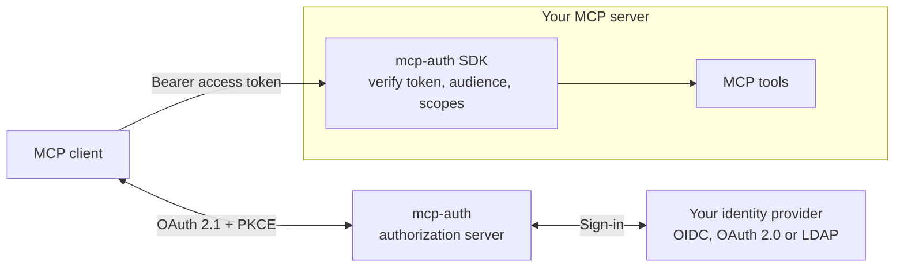

## How the pieces fit

## Start with your role

  <a class="home-path" href="./architecture">
    <strong>Deploy the authorization server</strong>
    Understand the flow, configure a connector and work through the production checklist.
  </a>
  <a class="home-path" href="./auth-client">
    <strong>Protect an MCP server</strong>
    Add token validation, resource metadata and scopes with the Python, Go or TypeScript SDK.
  </a>
  <a class="home-path" href="./demo-example">
    <strong>Try it locally</strong>
    Run the complete Keycloak walkthrough on your own machine.
  </a>
  <a class="home-path" href="./development">
    <strong>Contribute</strong>
    Set up a checkout, run the tests and the shared SDK conformance cases.
  </a>

