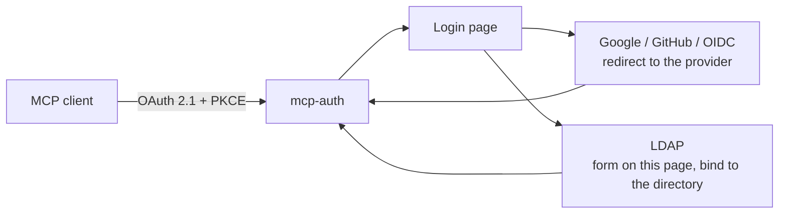

# Login methods

By default one `mcp-auth` process signs people in through one upstream
provider (`MCP_AUTH_CONNECTOR`). **Login methods** let one process offer
several: Google, GitHub, an LDAP directory, and any OIDC connector, side by
side on a login page. The person picks one; `mcp-auth` still issues the MCP
token.

`mcp-auth` stays an authorization broker. A login method answers one question,
*who is this person*. It does not pass upstream credentials to the MCP client,
and it does not hold secrets for downstream services (those belong to a
[resource-side connector](external-credentials.md)).



## Turn it on

Set `MCP_AUTH_LOGIN_METHODS_FILE` to a JSON file. It replaces
`MCP_AUTH_CONNECTOR`; setting both is a startup error. List an existing
connector as an `oidc` method to keep using it.

```bash
MCP_AUTH_LOGIN_METHODS_FILE=/etc/mcp-auth/login-methods.json
MCP_AUTH_GOOGLE_CLIENT_SECRET=...   # whatever the file's *_env names point at
```

See [`examples/login-methods.example.json`](../examples/login-methods.example.json).

```json
{
  "methods": [
    {"id": "google", "type": "google",
     "client_id_env": "MCP_AUTH_GOOGLE_CLIENT_ID",
     "client_secret_env": "MCP_AUTH_GOOGLE_CLIENT_SECRET",
     "allowed_domains": ["example.com"]},
    {"id": "github", "type": "github",
     "client_id_env": "MCP_AUTH_GITHUB_CLIENT_ID",
     "client_secret_env": "MCP_AUTH_GITHUB_CLIENT_SECRET",
     "allowed_orgs": ["acme"]},
    {"id": "corp", "type": "ldap", "label": "Company directory",
     "url": "ldaps://ldap.example.com",
     "bind_dn": "cn=mcp-auth,ou=services,dc=example,dc=com",
     "bind_password_env": "MCP_AUTH_LDAP_BIND_PASSWORD",
     "user_search_base": "ou=people,dc=example,dc=com",
     "user_filter": "(&(objectClass=person)(uid={username}))",
     "subject_attribute": "entryUUID",
     "claims": {"email": "mail", "name": "cn"}},
    {"id": "okta", "type": "oidc", "connector": "okta"}
  ]
}
```

Unknown fields are rejected, so a misspelled setting fails startup instead of
being ignored. Secrets are never in the file: they are named by `*_env` and
read from the environment.

Every entry has:

| Field | Meaning |
| --- | --- |
| `id` | Required. 1-32 lowercase letters, digits or hyphens. Used in the form action and the upstream state. |
| `type` | Required. `oidc`, `google`, `github` or `ldap`. |
| `label` | Button or heading text. Each type has a sensible default. |
| `subject_prefix` | Prepended to the person's subject. Defaults to `"<id>:"`. See [Subjects](#subjects-from-different-methods-never-collide). |
| `resources` | Optional array of exact MCP resource URLs. Explicit assignments override the unscoped default methods for those resources. |

## Require a login method for one resource

Use `resources` when a service must validate its own upstream credentials
before an MCP client receives an authorization code or access token:

```json
{"methods": [
  {"id":"company", "type":"oidc", "connector":"keycloak", "subject_prefix":""},
  {"id":"upstream-demo", "type":"oidc", "connector":"credential-gateway",
   "resources":["https://mcp.example/credential-demo/mcp"]}
]}
```

For `credential-demo`, only `upstream-demo` is eligible. The company login
remains the default for other resources. If multiple methods explicitly name
the same resource, the user can choose among those methods. With no matching
assignment and no unscoped default, authorization fails closed.

Assignments use exact URL equality, with no wildcard or prefix matching.
The pending authorization's stored resource controls method selection on
submission and callback; editing the picker URL or posting directly to a
default method cannot bypass the requirement. An assigned single redirect
method goes directly to its provider after consent.

In the credential-gateway pattern, that provider's login page collects the
saved service Login through the user's password manager and validates it with
the fixed upstream service. The gateway retains the upstream header values
and returns an opaque identity to `mcp-auth`. Only after that provider succeeds
does `mcp-auth` issue the MCP authorization code and token. The resource server
validates the MCP token and supplies its retained headers on later requests.
Neither credential values nor vault references belong in this methods file or
the MCP client's header configuration. The gateway owns credential custody,
upstream validation, expiry and header injection; this resource assignment is
the broker's login-routing policy, not a credential vault.

An `oidc` method can wrap a plain OAuth 2.0 connector by requesting scopes
without `openid` and configuring its userinfo endpoint. With explicit
authorization and token endpoints, this mode does not require OIDC discovery
or a `jwks_uri`. OIDC connectors still require signing keys and verified ID
tokens; omitting keys does not downgrade an OIDC login.

Keep subject prefixes disjoint, including when methods serve different
resources. Use an explicit empty prefix on a migrated existing method only
when its subjects must remain unchanged.

One method that redirects (for example only Google) skips the picker and goes
straight to the provider. Two or more, or any LDAP method, show the login
page.

## Register the callback

Every redirect method (`google`, `github`, `oidc`) uses the same redirect URI,
`<MCP_AUTH_ISSUER>/identity/callback` (or `MCP_AUTH_IDENTITY_CALLBACK_URL`).
Register it with each provider's OAuth app.

## Method types

### `google`

Sign in with Google (OIDC, fixed endpoints). The ID token is verified by the
same code as every other OIDC connector: signature, issuer, audience, expiry
and nonce.

| Field | Meaning |
| --- | --- |
| `client_id` or `client_id_env` | Exactly one. |
| `client_secret_env` | Required. |
| `allowed_domains` | Optional. Admits only accounts that one of these Google Workspace domains **manages** (Google's `hd` claim) and whose email is verified. List `gmail.com` to admit consumer Gmail accounts. Without it, any Google account can sign in. An address at a company domain alone is not enough: a consumer Google account can be created with any address. |

### `github`

Sign in with GitHub's OAuth web flow. GitHub is OAuth 2.0 rather than OIDC, so
identity comes from the API and the subject is the account's numeric id. A
login name can be renamed and later claimed by someone else, so it is never the
subject. The GitHub access token is used for the lookups and then discarded.

| Field | Meaning |
| --- | --- |
| `client_id` or `client_id_env` | Exactly one. |
| `client_secret_env` | Required. |
| `allowed_orgs` | Optional. Admits only **active** members of one of these organizations (a pending invitation is not membership). Requests the `read:org` scope. |
| `base_url`, `api_url` | Optional. Point at GitHub Enterprise Server. HTTPS only. |

### `ldap`

Sign in with a directory account (OpenLDAP, 389, Active Directory and similar).
The person types a username and password on the login page; `mcp-auth` binds to
the directory **as that person** to check the password. The password is used
for that one bind and is never stored, logged or compared by `mcp-auth`.

Find the person's entry in one of two ways:

- **Search** (`bind_dn`, `bind_password_env`, `user_search_base`, `user_filter`):
  a service account searches for the entry, which must match **exactly one**
  entry, then `mcp-auth` binds as it. `user_filter` contains `{username}` once.
- **Anonymous search** (`anonymous_search: true`, `user_search_base`,
  `user_filter`): for directories that allow unauthenticated reads, search
  without a service bind, then bind as the matched user with their password.
  Omit both `bind_dn` and `bind_password_env`. This must be enabled explicitly;
  missing service credentials never silently enable anonymous search. See
  [`examples/login-methods.ldap.example.json`](../examples/login-methods.ldap.example.json).
- **Direct bind** (`user_dn_template`): build the DN from the username, for
  example `uid={username},ou=people,dc=example,dc=com`. Use this when every
  account lives in one flat container. After the bind, `mcp-auth` reads the
  person's own entry back, so the account must be allowed to read it, and the
  subject comes from that entry (including `dn`, which is then the directory's
  spelling, not the typed one: `Alice` and `alice` are one account).

Configure one or the other, not both.

| Field | Meaning |
| --- | --- |
| `url` | `ldaps://host[:port]`, or `ldap://host[:port]` with `start_tls`. User information, search paths, queries and fragments are rejected; configure searches through the separate fields. |
| `start_tls` | Upgrade an `ldap://` connection. Not valid with `ldaps://`. |
| `ca_file` | PEM bundle of trusted CAs. Empty uses the system roots. |
| `subject_attribute` | **Required.** The attribute used as the person's subject, or `dn`. Choose one that never changes for a person (`entryUUID`, `employeeNumber`, `objectGUID`). A name that can be renamed or reused would let a new account inherit an old account's access. The attribute must have exactly one value and is used exactly as stored, with no trimming. Binary or non-printable values become `hex:` followed by their bytes in lowercase hex. Text starting with `hex:` is also encoded so it cannot collide with a binary identity. |
| `claims` | Optional map of claim name to attribute, for example `{"email": "mail"}`. |
| `username_label`, `password_label` | Optional form labels. |

What is enforced:

- Plain `ldap://` without `start_tls` is refused unless
  `MCP_AUTH_ALLOW_INSECURE_CONNECTORS` is set (development only). TLS is 1.2 or
  newer and the certificate is verified; there is no option to skip
  verification.
- An empty password is refused before the directory is contacted. Many servers
  treat a bind with a name and an empty password as a successful anonymous
  bind, which would sign anyone in as any account.
- The username is escaped before it enters the filter or the DN, so
  `*)(uid=*` is a literal name, not a query.
- An unknown account and a wrong password give the same answer. An outage or a
  broken service account is reported as "temporarily unavailable", never as a
  wrong password.
- Connections time out (5 s to connect, a further 10 s for the TLS handshake
  and StartTLS, 10 s per operation), a cancelled request closes its connection,
  and at most 16 connections per method are open at once.

Limit who may sign in with the filter itself, for example
`(&(objectClass=person)(uid={username})(memberOf=cn=mcp-users,ou=groups,dc=example,dc=com))`.

### `oidc`

Reuse a connector from `MCP_AUTH_CONNECTORS_FILE` by name:
`{"id": "okta", "type": "oidc", "connector": "okta"}`. This is the route to
Keycloak, Okta, Entra ID and any other OIDC or OAuth 2.0 provider. It is also
how to reach LDAP through Keycloak's LDAP federation, if you prefer that to a
native `ldap` method.

## Subjects from different methods never collide

A Google `sub`, a GitHub id and an LDAP `uid` can be the same string for
different people. Without a prefix two people could share an access-token
subject, and with it a refresh-token family and any per-user mapping at a
resource server. So each subject is prefixed with the method id by default
(`google:1008...`, `github:583231`, `corp:b1f6...`).

Startup refuses prefixes under which two methods could issue the same subject:
two methods cannot share a prefix, and one non-empty prefix cannot begin
another (with `a-` and `a-b-`, the id `b-1` from the first equals `1` from the
second).

To move from a single connector to login methods without changing existing
subjects, set `"subject_prefix": ""` on that method. Only one method may do
this, and its provider's subjects must not themselves start with another
method's prefix, which `mcp-auth` cannot check.

People who sign in through two methods are two different identities here;
accounts are not linked.

## Behaviour to know about

- **Sign-in is tied to the browser that approved consent.** Approving consent
  sets a short-lived, random, `HttpOnly`, `SameSite=Lax` cookie
  (`mcp_auth_login_*`, with the `__Host-` prefix over HTTPS), one per sign-in.
  The login form and the provider callback both require it. Without this,
  someone could approve consent for their own client and send the login link to
  a victim, who would sign in on the real server while the authorization code
  went to the attacker. A request from another browser is refused before any
  password is tried and does not use up the real browser's sign-in. Browsers
  that block cookies cannot sign in. Single-connector mode does not have this
  binding.
- **Failed attempts are throttled per account.** Five attempts on one account
  within five minutes lock that account out of that method until the window
  passes. An attempt is counted when it starts, so parallel requests cannot all
  pass while the first waits on the directory. An attempt that never tested the
  password (the directory could not be reached or refused the service account)
  is not counted and is shown as an outage. Any other failure, including one
  after the password was accepted such as an entry with no subject attribute, is
  counted and shown exactly like a wrong password, so a different response
  cannot reveal that a guess was right. Names are compared after
  trimming, collapsing whitespace, lowercasing and Unicode NFKC normalization,
  so `alice`, `Alice ` and a fullwidth spelling share one count. Aliases a
  directory defines itself, such as `DOMAIN\alice` and `alice@domain`, cannot
  be unified, so they get separate counts. The count is in memory and per
  replica. Up to 50,000 accounts are tracked. A locked account is never dropped
  to make room. When the table is full, an account with fewer than five
  failures is dropped instead (oldest first), which only resets its count, so
  filling the table costs about 50,000 requests to give back a handful of
  guesses on one account. If every tracked account is locked, a new account is
  refused until one expires. That needs roughly 250,000 failed attempts within
  five minutes, each a directory round trip, and it is a deliberate choice:
  letting new accounts in untracked would let anyone who fills the table guess
  without limit, which is worse than a temporary refusal. Rate limiting at your
  proxy is what keeps either from being practical. It does not key on client address, because behind a proxy
  everyone shares one. Add rate limiting at your proxy for volume attacks. A
  lockout can also be used to lock a known account out for a few minutes.
  Unknown accounts return slightly faster than known ones, which is a timing
  difference an attacker could use to test whether an account exists.
- **The sign-in window is bounded.** `MCP_AUTH_LOGIN_TTL` (default `10m`) is
  how long a person has from approving consent to finishing sign-in. Neither a
  failed password attempt nor choosing a provider extends it.
- **Records are kept apart.** Consent ids, login ids and provider states share
  one store table, and each kind is stored under its own key space, so an id
  from one stage cannot be used at another (a consent id is not a login id).
- **No upstream session is kept.** Login methods establish identity only. The
  `upstream_session` downstream-token strategy and RFC 8693 exchange against a
  single connector are not available in this mode; use
  [external credential connectors](external-credentials.md) for downstream
  access.
- **Consent and client redirect settings** come from the single-connector
  configuration today. In this mode the built-in consent page is used and
  `allowed_client_redirect_uris` is not applied.
- **Audit events** `login` (with `method` and `outcome`) record each attempt.
  They never contain passwords or usernames.

## Add another method

A method implements one of two small interfaces in
`auth-server/server/login.go`:

- `RedirectLoginMethod` (`Begin`, `Complete`): the browser leaves for a
  provider and returns to `/identity/callback`.
- `CredentialLoginMethod` (`Fields`, `Authenticate`): the person types
  credentials into the login page. Return `ErrInvalidCredentials` for a wrong
  password or unknown account. Return an error wrapping `ErrMethodUnavailable`
  only for a failure that cannot depend on whether the password was right (the
  backend could not be reached, a lookup failed before the password was
  checked). Every other error is treated as a failed attempt, counted and shown
  like a wrong password.

Register it in `ParseLoginMethods` with a config type, the same way `ldap`
does in `login_config.go`. The registry handles the page, the state, subject
prefixing, throttling and audit.
