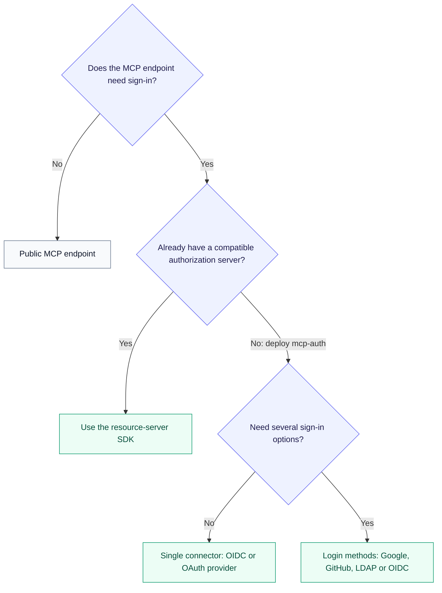
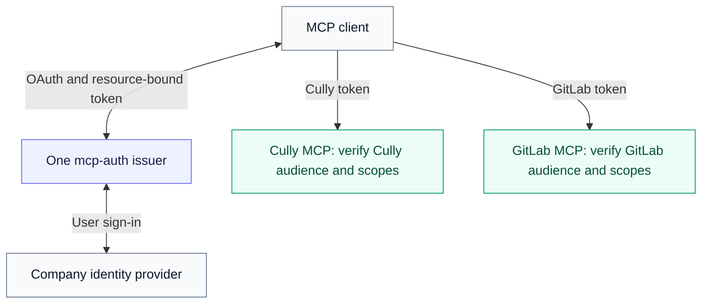
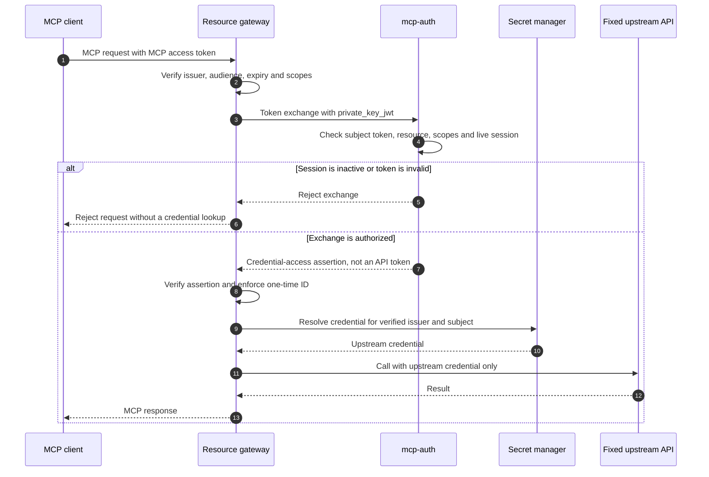

# Choose an authorization and credential flow

Start here when deciding how to protect an MCP server. mcp-auth supplies the
OAuth authorization server and resource-server authorization helpers. Your MCP
server owns tool behavior and application permissions.

## Choose a login mode



Choose the downstream-credential flow separately using the table below. Login
methods do not automatically supply a token for a downstream API.

## Supported combinations

| Use case | Choose | Boundary to preserve |
| --- | --- | --- |
| Expose public MCP tools without sign-in | Deploy the MCP resource server without an auth gate | MCP authorization is optional; mcp-auth is not needed for this endpoint. Local fixed-subject mode is only a test login. |
| Protect an MCP server with an existing compatible authorization server | Python, Go or TypeScript SDK only | Verify that server's issuer, signing algorithm, resource audience and required scopes. The bundled authorization server is optional. |
| Let employees sign in with one enterprise OIDC/OAuth provider | `MCP_AUTH_CONNECTOR` and a connector file | Register mcp-auth's callback with the IdP; publish MCP metadata on the resource server. |
| Offer Google, GitHub, LDAP and OIDC sign-in on one page | `MCP_AUTH_LOGIN_METHODS_FILE` | Do not also set `MCP_AUTH_CONNECTOR`. Method-prefixed subjects are distinct identities, not linked accounts. |
| Protect several MCP servers with one issuer | `MCP_AUTH_RESOURCES` and `MCP_AUTH_RESOURCE_SCOPES` | Each issued token targets one resource. Every resource server validates its own exact URL. |
| Call a downstream API using the user's existing provider token | Single connector, `downstream_token_strategy=upstream_session` | The provider's actual audience and scopes apply. Asking for a different audience does not mint a differently scoped credential. |
| Obtain a new downstream grant through a provider that supports token exchange | Single connector, `downstream_token_strategy=rfc8693` | Configure the upstream provider's trust/federation and grants; ordinary OIDC login alone does not establish that trust. |
| Proxy a fixed upstream with per-user credentials from your own secret manager | External credential connector, with either login mode | Exchange on every request, verify the credential-access assertion, then resolve credentials in the resource server. No vault credentials enter the MCP client or auth server. |
| Keep issuers, signing keys or per-provider downstream exchangers separate | Separate server processes and stores behind HTTPS | Multiple processes are an isolation choice; multiple resources alone do not require them. |

Login methods establish identity only. They do not retain an upstream token
session and cannot use the single-connector `upstream_session` or `rfc8693`
exchanger. Combine them with external credential connectors when downstream
credentials are needed. See [login methods](login-methods.md) and
[external credential connectors](external-credentials.md).

## Try a local authorization flow

From a checkout, follow [local development](development.md) to install Python,
Go and Node dependencies. Start the local authorization server in one terminal:

```bash
(
  cd auth-server
  MCP_AUTH_LOCAL_DEVELOPMENT=true \
  MCP_AUTH_REQUIRE_HTTPS=false \
  MCP_AUTH_REGISTRATION_ENABLED=true \
  GOWORK=off go run ./cmd/auth-server
)
```

In another terminal, start the [Go example](../examples/go-mcp/README.md) or
[TypeScript example](../examples/typescript-mcp/README.md). Both default to
`http://localhost:8081/mcp` and the authorization server at
`http://localhost:8080`; run one example at a time on that port.

Connect an OAuth-capable MCP client to `http://localhost:8081/mcp`. It discovers
resource and authorization metadata, registers if it uses DCR, opens consent,
exchanges a code using S256 PKCE, then calls the tool with an MCP access token.
The local server signs in as the fixed subject `local-user`; this does not test
an identity provider or real user authentication.

For the real Keycloak login and stored-provider-token exchange, use the
[Compose walkthrough](demo-example.md). Its hostnames and ports are internal
to Docker Compose; it is a test stack, not a desktop-client deployment template.

## One enterprise provider, several MCP resources

For example, one issuer can protect both a Cully MCP endpoint and a GitLab MCP
endpoint. Choose canonical public resource URLs and configure their scopes:

```bash
export MCP_AUTH_ISSUER=https://auth.example.com
export MCP_AUTH_RESOURCES=https://mcp.example.com/cully/mcp,https://mcp.example.com/gitlab/mcp
export MCP_AUTH_RESOURCE_SCOPES='{"https://mcp.example.com/cully/mcp":["tools:read"],"https://mcp.example.com/gitlab/mcp":["gitlab:use"]}'
export MCP_AUTH_CONNECTORS_FILE=/etc/mcp-auth/connectors.json
export MCP_AUTH_CONNECTOR=company
```

This is the resource/login portion of configuration, not a complete production
startup command. Add the signing key, durable store and restricted HTTPS proxy
from the [server guide](auth-server.md#run-and-configure).



The two token labels mean two separately requested tokens, not one token valid
at both servers. Cully's token must be rejected at GitLab, and vice versa.

Each MCP server advertises the same authorization server but its own resource
URL and scopes. A token for Cully must fail at the GitLab endpoint. A connector
is an identity/provider integration, not one connector per MCP resource.

Scope allowlists are **not per-user entitlements**. When a client omits `scope`,
the server grants the selected resource's configured scope list after consent.
Enforce team membership, object ownership and per-tool permissions in your
resource server or policy engine. Do not advertise a write scope if every
signed-in user should not be able to request it.

## A gateway with external per-user credentials

For a gateway that injects a GitLab token from its own vault:

1. Authenticate the MCP caller and verify the token for the gateway's exact
   MCP resource URL.
2. Authenticate the gateway to `/token` using its registered `private_key_jwt`.
   Request `urn:mcp-auth:token-type:credential-access-assertion` for that resource.
3. Verify the returned JWT's signature, required `credential-access+jwt` type,
   issuer, gateway client audience, expiry, resource, subject and session binding.
   Enforce one-time use of the assertion ID in the gateway.
4. Only after that successful exchange, resolve credentials for the verified
   `(issuer, subject, service)` and call the configured upstream.



The gateway, vault mapping and proxy are application code; this repository does
not ship a turnkey GitLab gateway or a secret-manager adapter. Never use the
assertion (`token_type=N_A`) as an upstream Bearer access token.

Disable exchange-result caching for this path: Python passes `use_cache=False`
on each exchange; TypeScript sets `cache: null`; Go leaves `Cache` nil. Ordinary
JWT verification is offline and does not consult refresh-token revocation.
This external-credential path checks the live refresh family on every exchange,
so a revoked session blocks the next exchange. See the full
[wire contract and revocation rules](external-credentials.md).

## Production deployment

The shipped binary serves HTTP. Terminate HTTPS at a reverse proxy, keep
`MCP_AUTH_REQUIRE_HTTPS=true`, set `MCP_AUTH_TRUST_PROXY_TLS=true`, overwrite
`X-Forwarded-Proto` at the proxy and restrict backend access to that proxy.
Changing the issuer URL to `https` alone does not create a TLS listener.

Configure a persistent signing key and a durable store. The binary supports
`memory` for local development and `sqlite` for a single durable instance.
Shared database and KMS/HSM integrations are extension interfaces for an
application embedding the server; they are not built-in CLI backend settings.
Protect stored upstream access/refresh tokens as usable credentials whenever
`upstream_session` is enabled. Follow the
[production checklist](auth-server.md#production-checklist).

## Verification coverage

These are executable repository checks, not certification of every vendor or
customer environment:

| Flow or boundary | Checked-in verification |
| --- | --- |
| Authorization Code + PKCE against Python, Go and TypeScript MCP servers | [SDK authorization E2E](../tests/e2e/test_mcp_oauth_flow.py) |
| Multiple OIDC providers, subject prefixes and browser binding | [Login-method E2E](../tests/e2e/test_login_methods_flow.py) |
| External assertions, wrong-resource denial, refresh and revocation | [Credential-access E2E](../tests/e2e/test_external_credentials_flow.py) |
| OIDC login and discovery | [Mock-provider E2E](../tests/e2e/test_oidc_provider_flow.py) |
| Keycloak and stored upstream-token exchange | [Compose stack](../deploy/docker-compose.e2e.yml) and [client](../tests/e2e/compose_client.py) |
| Resource-specific scopes and omitted-scope defaults | [Resource scope tests](../auth-server/server/resource_scopes_test.go), [default-scope tests](../auth-server/server/scope_default_test.go) |
| Direct SDK verifier parity | [Shared cases](../sdk-conformance/cases.json) and each SDK's conformance tests |
| Trusted-proxy HTTPS checks and resource audience binding | [Server boundary tests](../auth-server/server/server_test.go) |

Google, GitHub and LDAP behavior has controlled Go test coverage; these E2E
jobs do not sign in to live Google/GitHub accounts or a production LDAP server.
Verify your provider's callback, directory filters, identity claims and policy
with real accounts before deployment.

For commands that execute these checks, see
[development verification](development.md#verify-the-supported-use-cases).
